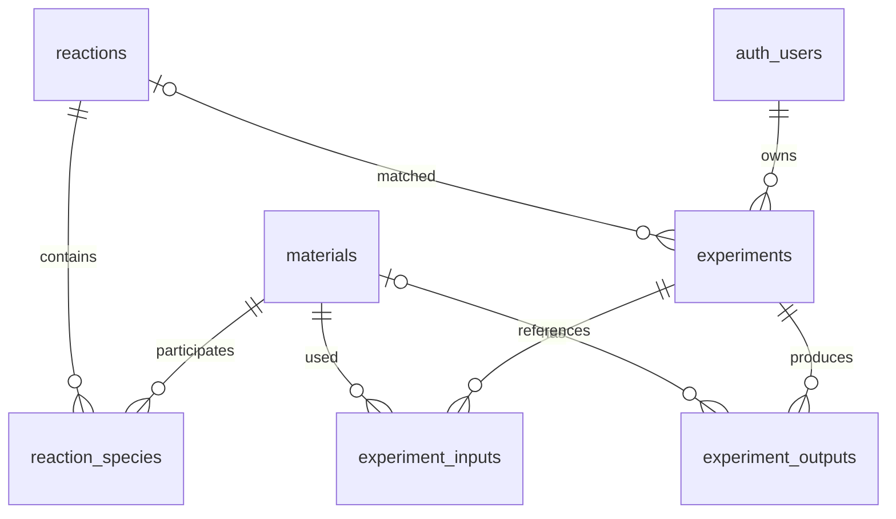

# CHEM LAB Supabase 데이터베이스

## 구성

- `materials`: 물질명, 화학식, 상태, 몰 질량, 밀도와 설명
- `reactions`: 반응식, 반응 유형, 시각 효과와 적용 조건
- `reaction_species`: 각 반응의 반응물·생성물·용매 및 화학량론 계수
- `experiments`: 사용자별 실험 조건과 최종 판정 요약
- `experiment_inputs`: 실험에 투입한 물질, 양, 단위와 환산 몰수
- `experiment_outputs`: 생성물과 남은 반응물의 계산 결과
- `reaction_catalog`: 반응과 구성 물질을 한 번에 조회하는 읽기 전용 뷰

## 테이블 관계

반응식은 물질 ID를 배열로 저장하지 않고 `reaction_species`에서 역할과 화학량론 계수를 관리합니다. 따라서 새로운 물질이나 생성물을 추가해도 반응 테이블의 구조를 변경할 필요가 없습니다. 실험 당시의 판정 결과는 `experiments.result_snapshot`에도 함께 보관하여 이후 반응 DB 내용이 수정되더라도 과거 결과를 재현할 수 있게 설계했습니다.

## 적용 순서

1. Supabase에서 새 프로젝트 생성
2. Supabase CLI 연결 후 `supabase db push` 실행 또는 SQL Editor에서 `migrations/20261027000000_initial_chem_lab_schema.sql` 실행
3. SQL Editor에서 `seed.sql` 실행
4. 프로젝트 URL과 anon key를 웹 앱의 환경 변수로 등록
5. Supabase Auth 연결 후 실험 기록 저장 기능 활성화

## 보안 정책

물질과 반응 데이터는 익명 사용자도 활성 데이터만 읽을 수 있습니다. 수정 권한은 클라이언트에 제공하지 않습니다. 실험 기록과 입·출력 상세 정보는 로그인한 사용자가 자신의 기록만 조회·추가·수정·삭제할 수 있습니다. 관리자 데이터 입력은 Supabase Dashboard 또는 서버의 service role을 사용해야 합니다.

## 현재 범위

현재 사이트에 존재하는 NaCl, H₂O, HCl, NaOH, CuSO₄와 관련 생성물을 초기 데이터로 포함합니다. 중화, 침전, 용해 반응 3개를 등록했으며, 기존 화면은 아직 로컬 TypeScript 배열을 사용합니다. 다음 연결 단계에서 `materials`와 `reaction_catalog` 조회 결과로 해당 배열과 반응 규칙을 교체하면 됩니다.
